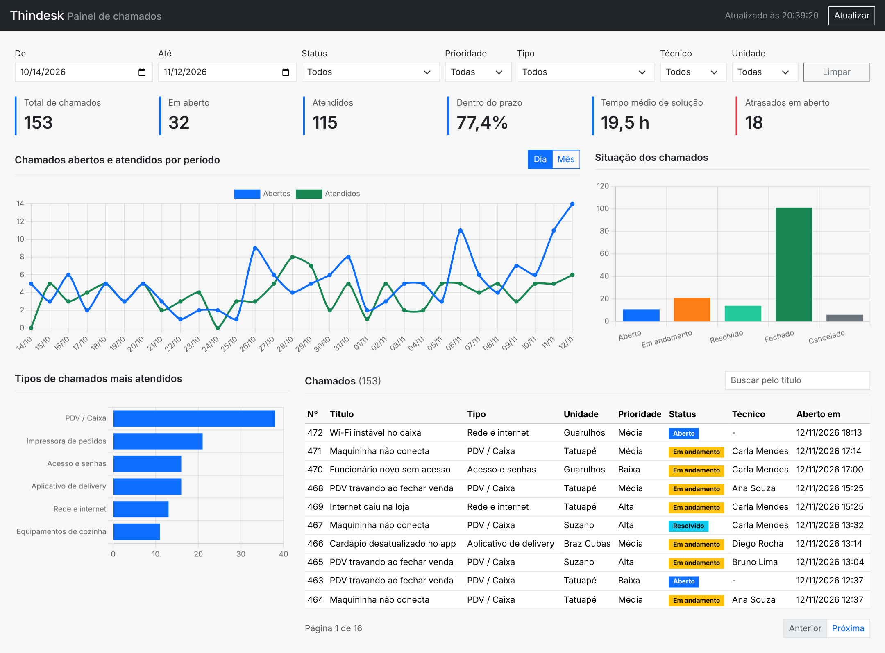

# Thindesk

Dashboard administrativo para acompanhar os chamados técnicos de uma rede de pizzarias.



## Tecnologias

- API: Node.js, Express e SQLite
- Dashboard: React, Bootstrap e Chart.js
- Testes: Vitest e Supertest

## Como rodar

Precisa do Node.js 22.13 ou mais novo.

```
npm install
npm run dev
```

- Dashboard: http://localhost:5173
- API: http://localhost:3333/api

Para rodar os testes: `npm test`

## Documentação

- [Documentação completa](docs/DOCUMENTACAO.md): requisitos, regras, endpoints e testes
- [Testes manuais](docs/evidencias/testes-manuais.md)
- [Testes automatizados](docs/evidencias/testes-automatizados.txt)
- [Vídeo de apresentação](docs/apresentacao.mp4)

## Estrutura

```
api/    API e banco de dados
web/    Dashboard
docs/   Documentação e evidências
```
