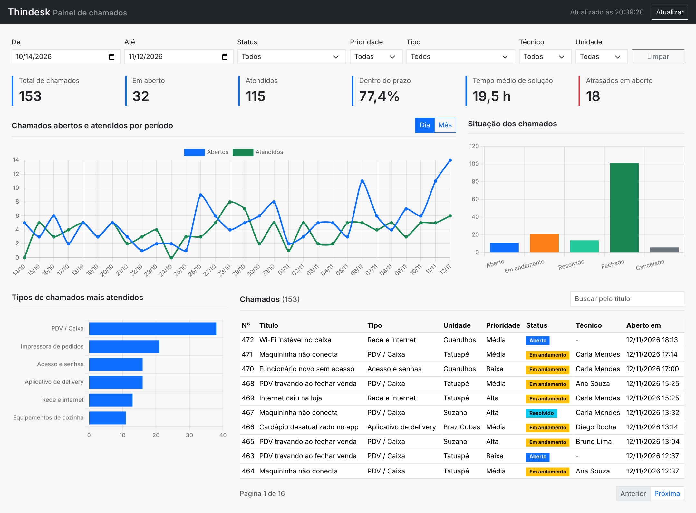

# Thindesk - Documentação

Dashboard administrativo para acompanhar os chamados técnicos de uma rede de pizzarias. As lojas abrem chamados quando algo para de funcionar (caixa, impressora de pedidos, aplicativo de delivery, internet, equipamentos da cozinha) e o responsável usa o painel para ver o andamento, a situação dos chamados e o que mais dá problema.

O sistema tem duas partes:

- **API** em Node.js com Express e banco SQLite (módulo `node:sqlite` do próprio Node).
- **Dashboard** em React com Bootstrap e Chart.js, que consome a API.

## 1. Requisitos funcionais

| Código | Requisito | Onde está |
|---|---|---|
| RF01 | Indicadores gerais: total, em aberto, atendidos, % dentro do prazo, tempo médio de solução e atrasados | `GET /api/indicadores` e componente `Indicadores` |
| RF02 | Gráfico de chamados abertos e atendidos por dia ou por mês | `GET /api/chamados-por-periodo` e `GraficoPeriodo` |
| RF03 | Situação dos chamados (quantidade por status) | `GET /api/situacao` e `GraficoSituacao` |
| RF04 | Tipos de chamados mais atendidos | `GET /api/tipos` e `GraficoTipos` |
| RF05 | Filtros por período, status, prioridade, tipo, técnico e unidade | Parâmetros das rotas e componente `Filtros` |
| RF06 | Integração do dashboard com a API | `web/src/api.js` |
| RF07 | Atualização e tratamento dos dados: mudar status, registrar considerações técnicas e recarregar o painel a cada 30 segundos | `PATCH /api/chamados/:id`, `POST /api/chamados/:id/consideracoes` e `App.jsx` |

## 2. Requisitos não funcionais

| Código | Requisito |
|---|---|
| RNF01 | A API responde em JSON e usa os códigos HTTP 200, 201, 400, 404, 422 e 500. |
| RNF02 | Os dados de entrada são validados e as consultas usam parâmetros (`?`), evitando SQL injection. |
| RNF03 | O sistema roda só com Node.js 22.13 ou superior, sem instalar banco de dados. |
| RNF04 | A interface é responsiva (Bootstrap) e funciona no computador e no celular. |
| RNF05 | O código fica versionado no GitHub seguindo o gitflow. |

## 3. Regras de negócio

- O prazo do chamado depende da prioridade: alta 8 horas, média 24 horas e baixa 48 horas.
- Status possíveis: aberto, em andamento, resolvido, fechado e cancelado.
- Mudanças permitidas:
  - aberto → em andamento ou cancelado
  - em andamento → resolvido ou cancelado
  - resolvido → fechado ou em andamento (reabertura)
- Para colocar em andamento é preciso ter um técnico.
- Para resolver é preciso descrever a solução (mínimo de 10 caracteres). A solução vira uma consideração técnica do chamado.
- Chamado cancelado não recebe novas considerações.

## 4. Banco de dados

```
unidades (id, nome)
categorias (id, nome)
tecnicos (id, nome)
chamados (id, titulo, categoria_id, unidade_id, tecnico_id, prioridade, status, aberto_em, prazo_em, resolvido_em)
consideracoes (id, chamado_id, autor, texto, criado_em)
```

Na primeira execução o banco é criado em `api/dados/thindesk.db` com cerca de 480 chamados de exemplo dos últimos 4 meses. Para gerar de novo, basta apagar esse arquivo.

## 5. Endpoints

Endereço base: `http://localhost:3333/api`

Formato de erro em todas as rotas:

```json
{ "erro": "Filtro inválido", "campos": ["data_inicio", "status"] }
```

| Código | Quando acontece |
|---|---|
| 400 | Parâmetro ou corpo inválido, ou JSON mal formado |
| 404 | Chamado ou rota não encontrada |
| 422 | A operação não é permitida pela regra de negócio |
| 500 | Erro interno |

### Filtros

As rotas de indicadores, gráficos e lista de chamados aceitam estes parâmetros, todos opcionais:

| Parâmetro | Exemplo | Descrição |
|---|---|---|
| data_inicio | 2026-10-01 | Abertos a partir desta data |
| data_fim | 2026-10-31 | Abertos até esta data |
| status | em_andamento | aberto, em_andamento, resolvido, fechado ou cancelado |
| prioridade | alta | baixa, media ou alta |
| categoria_id | 1 | Tipo do chamado |
| tecnico_id | 2 | Técnico |
| unidade_id | 3 | Unidade (loja) |

### GET /api/indicadores

Exemplo: `GET /api/indicadores?data_inicio=2026-10-01&data_fim=2026-10-31`

```json
{
  "total": 122,
  "em_aberto": 0,
  "atendidos": 115,
  "cancelados": 7,
  "atrasados": 0,
  "sla_percentual": 73,
  "tempo_medio_horas": 21
}
```

Erros: 400 quando algum filtro é inválido.

### GET /api/chamados-por-periodo

Parâmetro extra: `agrupamento` = `dia` (padrão) ou `mes`.

Exemplo: `GET /api/chamados-por-periodo?agrupamento=mes&data_inicio=2026-09-01`

```json
[
  { "periodo": "2026-09", "abertos": 110, "atendidos": 103 },
  { "periodo": "2026-10", "abertos": 122, "atendidos": 112 },
  { "periodo": "2026-11", "abertos": 77, "atendidos": 49 }
]
```

Erros: 400 para filtro ou agrupamento inválido.

### GET /api/situacao

```json
[
  { "status": "aberto", "nome": "Aberto", "total": 11 },
  { "status": "em_andamento", "nome": "Em andamento", "total": 21 },
  { "status": "resolvido", "nome": "Resolvido", "total": 14 },
  { "status": "fechado", "nome": "Fechado", "total": 406 },
  { "status": "cancelado", "nome": "Cancelado", "total": 20 }
]
```

Erros: 400 para filtro inválido.

### GET /api/tipos

Lista os tipos de chamado ordenados pelos mais atendidos (resolvidos e fechados).

```json
[
  { "tipo": "PDV / Caixa", "total": 149, "atendidos": 134 },
  { "tipo": "Impressora de pedidos", "total": 99, "atendidos": 87 }
]
```

Erros: 400 para filtro inválido.

### GET /api/filtros

Retorna as listas usadas nos selects do dashboard: `categorias`, `tecnicos`, `unidades` e `status`.

### GET /api/chamados

Parâmetros extras: `pagina` (padrão 1) e `busca` (procura no título). Retorna 10 chamados por página.

Exemplo: `GET /api/chamados?status=em_andamento`

```json
{
  "dados": [
    {
      "id": 471,
      "titulo": "Maquininha não conecta",
      "prioridade": "media",
      "status": "em_andamento",
      "aberto_em": "2026-11-12 17:14:00",
      "prazo_em": "2026-11-13 17:14:00",
      "resolvido_em": null,
      "categoria": "PDV / Caixa",
      "unidade": "Tatuapé",
      "tecnico": "Carla Mendes"
    }
  ],
  "total": 21,
  "pagina": 1,
  "paginas": 3
}
```

Erros: 400 para filtro ou página inválida.

### GET /api/chamados/:id

Retorna o chamado com suas considerações técnicas.

```json
{
  "id": 5,
  "titulo": "Maquininha não conecta",
  "prioridade": "alta",
  "status": "fechado",
  "aberto_em": "2026-07-18 12:15:00",
  "prazo_em": "2026-07-18 20:15:00",
  "resolvido_em": "2026-07-18 21:15:00",
  "categoria": "PDV / Caixa",
  "unidade": "Guarulhos",
  "tecnico": "Diego Rocha",
  "consideracoes": [
    { "id": 5, "autor": "Diego Rocha", "texto": "Peça substituída.", "criado_em": "2026-07-18 21:15:00" }
  ]
}
```

Erros: 400 para id que não é número e 404 para chamado inexistente.

### PATCH /api/chamados/:id

Muda o status do chamado.

| Campo | Obrigatório | Descrição |
|---|---|---|
| status | sim | Novo status |
| tecnico_id | para em_andamento, se o chamado ainda não tiver técnico | Técnico responsável |
| solucao | para resolvido | Descrição da solução (mínimo 10 caracteres) |

Exemplo:

```json
{ "status": "resolvido", "solucao": "Cabo de rede trocado e testado." }
```

A resposta é o chamado atualizado.

Erros:

```json
{ "erro": "Escolha um técnico para iniciar o atendimento" }
{ "erro": "Descreva a solução com pelo menos 10 caracteres" }
{ "erro": "Não é possível mudar de fechado para aberto" }
```

Os três acima retornam 422. Status inválido ou JSON mal formado retornam 400, e chamado inexistente retorna 404.

### POST /api/chamados/:id/consideracoes

Registra uma consideração técnica.

```json
{ "autor": "Bruno Lima", "texto": "Unidade confirmou que está funcionando." }
```

Resposta 201:

```json
{ "id": 481, "chamado_id": 472, "autor": "Bruno Lima", "texto": "Unidade confirmou que está funcionando.", "criado_em": "2026-11-12 20:39:00" }
```

Erros: 400 sem autor ou com texto menor que 5 caracteres, 404 para chamado inexistente e 422 para chamado cancelado.

## 6. Testes

**Automatizados:** 14 testes com Vitest e Supertest em `api/testes/api.test.js`. Eles usam um banco em memória e cobrem indicadores, filtros, gráficos, lista, detalhe, regras de mudança de status, considerações e erros. Para rodar: `npm test`. Resultado: [evidencias/testes-automatizados.txt](evidencias/testes-automatizados.txt) (14 de 14 passando).

**Manuais:** 20 requisições feitas na API rodando, com a resposta de cada uma, em [evidencias/testes-manuais.md](evidencias/testes-manuais.md) (20 de 20 com o resultado esperado).

**Telas:**

| Tela | O que mostra |
|---|---|
| [01-dashboard.png](evidencias/telas/01-dashboard.png) | Dashboard com os dados dos últimos 30 dias |
| [02-filtros-aplicados.png](evidencias/telas/02-filtros-aplicados.png) | Filtro de status "em andamento" e prioridade alta |
| [03-detalhe-chamado.png](evidencias/telas/03-detalhe-chamado.png) | Detalhe de um chamado aberto |
| [04-regra-tecnico-obrigatorio.png](evidencias/telas/04-regra-tecnico-obrigatorio.png) | API recusando iniciar o chamado sem técnico |
| [05-chamado-resolvido.png](evidencias/telas/05-chamado-resolvido.png) | Chamado resolvido com a solução registrada |



## 7. Gitflow

| Branch | Uso |
|---|---|
| main | Versão final (tag v1.0.0) |
| develop | Integração |
| feature/banco | Criação do banco e dos dados de exemplo |
| feature/api | Implementação da API com as rotas ligadas ao banco e os testes |
| feature/dashboard | Dashboard em React |
| feature/documentacao | Documentação e evidências |
| release/1.0.0 | Fechamento da versão |

## 8. Como rodar

Precisa do Node.js 22.13 ou mais novo.

```
npm install
npm run dev
```

- Dashboard: http://localhost:5173
- API: http://localhost:3333/api/indicadores
